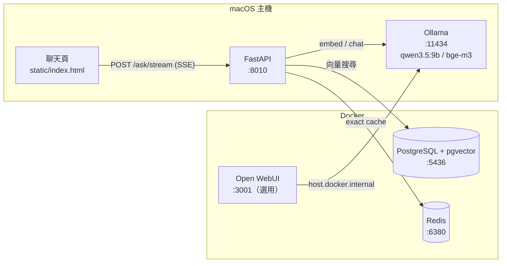

# local-rag-kit

在自己的電腦上跑完整 RAG（Retrieval-Augmented Generation）流程的最小可用骨架：文件 ETL、向量檢索、地端 LLM 生成、兩層快取、串流聊天介面。資料不離開本機，也可以一行設定切到雲端模型。

```
文件 ──ETL──▶ pgvector ◀──檢索── 問題 ──▶ 地端 LLM ──▶ 串流回答 + 引用來源
                                  │
                                Redis 快取
```

- 全部服務只綁 `127.0.0.1`，不需要任何雲端帳號就能跑
- 約 800 行程式碼（Python 500 行 + 單頁 HTML），沒有 LangChain 這類框架，每一步都看得到
- 附範例資料（員工手冊 Markdown + 商品 CSV），啟動後可以直接問

---

## 目錄

- [技術選型](#技術選型)
- [系統架構](#系統架構)
- [快速開始](#快速開始)
- [使用方式](#使用方式)
- [運作原理](#運作原理)
- [設定](#設定)
- [專案結構](#專案結構)
- [實測數據](#實測數據)
- [設計取捨](#設計取捨)
- [已知限制與後續方向](#已知限制與後續方向)

---

## 技術選型

| 層 | 技術 | 用途 | 選用理由 |
|---|---|---|---|
| LLM 執行環境 | **Ollama**（macOS 原生） | 跑地端模型、提供 HTTP API | 原生執行吃得到 Apple Silicon 的 Metal GPU；放進 Docker 只能用 CPU |
| 生成模型 | **qwen3.5:9b** | 依參考資料生成答案 | 繁中能力好、9B 在 18GB RAM 的筆電跑得動 |
| Embedding 模型 | **bge-m3**（1024 維） | 把文字轉成向量 | 多語、中文檢索表現穩定，Ollama 可直接拉 |
| 向量資料庫 | **PostgreSQL 17 + pgvector**（HNSW 索引） | 存 chunk 與向量、相似度搜尋 | 向量與 metadata 同庫，可 JOIN、可用 transaction |
| 快取 | **Redis 7** | 精確比對快取（L1） | 毫秒級回應，TTL 與 LRU 淘汰 |
| API | **FastAPI** + Uvicorn | REST + SSE 串流 | 型別驗證、自動產生 Swagger |
| DB driver | psycopg 3 + psycopg-pool + pgvector-python | 連線池、向量型別轉換 | 同步 API 簡單直觀，FastAPI 自動丟 threadpool |
| HTTP client | httpx | 呼叫 Ollama / OpenAI 相容 API | 支援串流 |
| 文件解析 | pypdf、標準庫 csv | PDF / CSV / Markdown / TXT 抽取 | 依賴最少 |
| 前端 | 原生 HTML + CSS + JS | 聊天介面 | 無建置、無 CDN，斷網可用 |
| 模型測試介面 | Open WebUI（選用） | 直接跟模型對話、調 prompt | 與 RAG 流程分開，比較用 |
| 套件管理 | uv | Python 依賴與虛擬環境 | 快、lockfile 可重現 |
| 容器 | Docker Compose | 起 pgvector、Redis、Open WebUI | 一行啟動、volume 保存資料 |

---

## 系統架構



Ollama 不放進容器：Docker Desktop 在 macOS 上跑在 Linux VM 裡，拿不到 Metal GPU，9B 模型只用 CPU 會慢到不能用。

---

## 快速開始

### 需求

- macOS（Apple Silicon）或 Linux，建議 16GB 以上 RAM
- [Docker Desktop](https://www.docker.com/products/docker-desktop/)
- [Ollama](https://ollama.com/)
- [uv](https://docs.astral.sh/uv/)

### 1. 下載模型

```bash
ollama pull qwen3.5:9b
ollama pull bge-m3
```

### 2. 設定環境變數

```bash
cp .env.example .env
```

預設值就能在本機跑，不需修改。

### 3. 啟動資料庫與快取

```bash
docker compose up -d --wait
```

### 4. 安裝依賴並匯入範例資料

```bash
uv sync
uv run --env-file .env python -m app.etl data
```

### 5. 啟動 API

```bash
uv run --env-file .env uvicorn app.main:app --port 8010 --reload
```

打開 http://localhost:8010/ 開始提問。

### 選用：Open WebUI

```bash
docker compose --profile ui up -d
```

打開 http://localhost:3001 。第一次啟動會從網路下載它自己的 embedding 模型（約 2 分鐘），之後存在 volume 裡，可離線使用。

---

## 使用方式

### 介面

| 網址 | 說明 |
|---|---|
| http://localhost:8010/ | RAG 聊天頁：串流回答、引用來源與片段預覽、快取命中層與耗時、上傳文件、清快取 |
| http://localhost:8010/docs | Swagger UI，逐支測 API |
| http://localhost:3001 | Open WebUI，直接跟模型對話，不經過本專案的 RAG |

### API

| Method | Path | 說明 |
|---|---|---|
| `GET` | `/health` | PostgreSQL / Redis / Ollama 狀態、chunk 數、目前使用的模型 |
| `POST` | `/ingest` | multipart 上傳 `.pdf` `.md` `.txt` `.csv`，單檔上限 20MB；內容沒變會跳過 |
| `GET` | `/search?q=&k=` | 只做檢索，回傳 top-k chunk 與相似度，用來 debug 切塊與召回 |
| `POST` | `/ask` | `{"question": "...", "use_cache": true}` → 答案、來源、快取層、耗時 |
| `POST` | `/ask/stream` | 同上，SSE 串流，事件依序為 `sources` → 多個 token → `done`（`{cache, ms}`） |
| `DELETE` | `/cache` | 清空所有快取 |

```bash
curl -s -X POST localhost:8010/ask \
  -H 'content-type: application/json' \
  -d '{"question":"試用期可以遠端工作嗎？"}'
```

```json
{
  "answer": "不可以，試用期（前三個月）的員工不適用遠端工作 [1]。",
  "sources": [{"source": "handbook.md", "chunk_index": 2, "score": 0.7287, "preview": "## 遠端工作\n每週最多可遠端工作 2 天…"}],
  "cache": "miss",
  "ms": 2886
}
```

```bash
# 中文 query 要 urlencode
curl -s -G localhost:8010/search --data-urlencode "q=發票期限" -d k=3
```

### 匯入自己的資料

```bash
# 整個資料夾（遞迴）或單一檔案
uv run --env-file .env python -m app.etl path/to/docs
```

或在聊天頁按「上傳文件」。

---

## 運作原理

### ETL：文件 → 向量

```
extract → clean → chunk → embed → upsert → 清快取
```

1. **Extract**（`etl.extract`）：PDF 逐頁抽文字；CSV 每列攤平成 `欄位: 值；欄位: 值`；Markdown / TXT 直接讀。
2. **Clean**（`etl.clean`）：統一換行、全形空白、壓縮多餘空行。
3. **Chunk**（`etl.chunk`）：
   - 以空行切段落，累積到 `CHUNK_SIZE`（預設 500 字）為一塊
   - 遇到 Markdown 標題（`#`）強制斷開，不跨主題、不帶 overlap
   - 超長段落用固定長度切，相鄰塊重疊 `CHUNK_OVERLAP`（預設 80 字）避免語意被切斷
   - CSV 一列就是一塊，保證同一筆資料完整
4. **Embed**：每 32 塊一批送 bge-m3。
5. **Upsert**：先比對檔案 sha256，沒變就跳過；有變則在**同一個 transaction** 內刪除舊文件（`ON DELETE CASCADE` 連帶刪舊 chunks）並寫入新的，不會出現新舊混雜的狀態。
6. **清快取**：知識庫變了，舊答案可能過期。

### 查詢：問題 → 答案

```
L1 Redis exact → embed → [L2 semantic cache] → pgvector top-k → prompt → LLM → 寫回快取
```

1. **L1 精確快取**：key = `sha256(模型名稱 | top_k | 正規化後的問題)`，命中直接回傳（約 1ms）。
2. **Embed 問題**：bge-m3 轉成 1024 維向量。
3. **L2 語意快取**（預設關閉，原因見[設計取捨](#設計取捨)）。
4. **檢索**：
   ```sql
   SELECT d.source, c.chunk_index, c.content, 1 - (c.embedding <=> $1) AS score
   FROM chunks c JOIN documents d ON d.id = c.document_id
   ORDER BY c.embedding <=> $1
   LIMIT 4;
   ```
   `<=>` 是 pgvector 的 cosine distance，走 HNSW 索引。
5. **組 prompt**：把 top-k chunk 編號成 `[1]`～`[4]`，要求模型先給結論、句尾標註引用、資料完全沒提到才拒答。
6. **生成**：qwen3.5:9b，`temperature 0.2`，`think: false`（開 thinking 單題會到分鐘級）。
7. **寫回快取**，TTL 預設 1 小時。

### 資料表

```sql
documents       (id, source UNIQUE, sha256, ingested_at)
chunks          (id, document_id → documents ON DELETE CASCADE, chunk_index, content, embedding vector(1024))
semantic_cache  (id, question, answer, sources JSONB, embedding vector(1024), created_at)
```

`chunks.embedding` 與 `semantic_cache.embedding` 都建了 HNSW（`vector_cosine_ops`）索引。Schema 在 API 或 ETL 啟動時自動建立，向量維度由 `EMBED_DIM` 決定。

直接查看資料：

```bash
docker exec -it aikit-pgvector psql -U aikit -d aikit
```

### 串流前端

`/ask/stream` 用 POST 帶 JSON，瀏覽器原生的 `EventSource` 只支援 GET，所以前端用 `fetch` + `ReadableStream` 自己解析 SSE：以 `\n\n` 切事件，讀 `event:` 與 `data:` 欄位。模型輸出一律先 escape 再把 `[n]` 轉成上標，避免 XSS。

---

## 設定

所有設定都在 `.env`（範本：`.env.example`）。

| 變數 | 預設 | 說明 |
|---|---|---|
| `LLM_PROVIDER` | `ollama` | `ollama` 或 `openai`（任何 OpenAI 相容端點） |
| `EMBED_PROVIDER` | `ollama` | 同上，可與 LLM 分開設定 |
| `CHAT_MODEL` | `qwen3.5:9b` | 生成模型 |
| `EMBED_MODEL` | `bge-m3` | Embedding 模型 |
| `EMBED_DIM` | `1024` | 向量維度，必須與 embedding 模型一致 |
| `OPENAI_BASE_URL` / `OPENAI_API_KEY` | Gemini 端點 / 空 | `openai` provider 用 |
| `CHUNK_SIZE` / `CHUNK_OVERLAP` | `500` / `80` | 切塊大小與重疊（字元） |
| `TOP_K` | `4` | 檢索幾塊 |
| `CACHE_TTL` | `3600` | 快取秒數 |
| `SEMANTIC_CACHE` | `off` | 語意快取開關 |
| `SEMANTIC_CACHE_THRESHOLD` | `0.95` | 語意快取相似度門檻 |
| `PG_*` / `REDIS_*` | 見範本 | 連線設定；port 刻意避開 5432 / 6379 |

### 切換到雲端模型

```env
LLM_PROVIDER=openai
OPENAI_BASE_URL=https://generativelanguage.googleapis.com/v1beta/openai
OPENAI_API_KEY=your-key
CHAT_MODEL=gemini-flash-latest
```

只換生成、保留地端檢索是常見的混合架構：資料向量化在本機完成，只有檢索到的少量片段送到雲端。

換 embedding 模型時維度通常會變（例如 `gemini-embedding-001` 是 768），要同步改 `EMBED_DIM` 並重建資料庫：

```bash
docker compose down -v && docker compose up -d --wait
uv run --env-file .env python -m app.etl data
```

---

## 專案結構

```
.
├── app/
│   ├── main.py          FastAPI 路由、快取流程、SSE 串流、上傳驗證
│   ├── etl.py           抽取、清洗、切塊、冪等寫入；也可當 CLI
│   ├── rag.py           檢索 SQL、system prompt、組 prompt
│   ├── llm.py           embed / chat / chat_stream，Ollama 與 OpenAI 相容 API 兩種實作
│   ├── cache.py         L1 Redis 精確快取、L2 pgvector 語意快取、清除
│   ├── db.py            schema 建立、連線池
│   ├── config.py        讀取環境變數
│   └── static/
│       └── index.html   聊天介面
├── data/                範例資料（員工手冊、商品 CSV）
├── docker-compose.yml   pgvector、Redis、Open WebUI（profile: ui）
├── pyproject.toml
├── uv.lock
└── .env.example
```

---

## 實測數據

環境：MacBook Pro M3 Pro、18GB RAM、Ollama 0.35、範例資料 10 個 chunk。

| 項目 | 結果 |
|---|---|
| 生成一題（未命中快取） | 2–4 秒（模型冷啟動時約 10 秒） |
| L1 快取命中 | 約 1ms（API 內部），前端含網路約 10ms |
| 8 題測試集 | 8 題回答正確，資料外問題正確拒答 |

bge-m3 問句相似度：

| 問句 A | 問句 B | Cosine | 意思 |
|---|---|---|---|
| 報帳 3000 **以下**誰核准？ | 報帳 3000 **以上**誰核准？ | **0.971** | 相反 |
| 特休怎麼算 | 特休天數如何計算 | 0.905 | 相同 |
| 試用期可以遠端工作嗎？ | 正職員工可以遠端工作嗎？ | 0.844 | 不同 |
| 試用期可以遠端工作嗎？ | 試用期間能不能在家上班 | 0.836 | 相同 |
| 密碼多久要換 | 密碼要幾碼 | 0.764 | 不同 |

---

## 設計取捨

**語意快取預設關閉。** 上表顯示，意思相反的問題（0.971）比同義改寫（0.836）更相似，任何門檻都會誤判。設太低會把「3000 以下」的答案回給「3000 以上」；設太高則幾乎不會命中。要開啟的話，應加二次驗證（例如用 LLM 判斷兩題是否等價，或比對數字與否定詞），或只用在答案固定的 FAQ 場景。

**用 pgvector，不用專門的向量資料庫。** 向量、原文、metadata 同庫，可以 JOIN、用 WHERE 做權限或分類過濾，ETL 也能放在單一 transaction。資料量到千萬級或需要分散式時，Qdrant / Milvus 才有明顯優勢。

**快取失效策略。** 匯入任何文件就清空全部快取；key 帶模型名稱與 top_k，換設定不會拿到舊答案。對小型知識庫來說，簡單比精準重要。

**Prompt 的拒答條件放最後。** 第一版把「沒資料就回答沒有相關資訊」放在第一條規則，9B 模型會把它當預設答案，連資料裡有的問題也拒答。改成先要求作答、拒答限定「完全沒提到主題」後才正常。

**不用 LangChain / LlamaIndex。** 這個規模的流程用框架反而看不到每一步，除錯時要繞過抽象層。

**安全。**
- 所有 port 只綁 `127.0.0.1`
- 上傳採副檔名白名單，大小在伺服器端檢查，檔名只用來顯示、不拼進任何路徑
- 前端輸出一律 escape
- `.env` 不進版控

---

## 已知限制與後續方向

**已知問題**
- 過度推論：問「可以把客戶資料丟給 ChatGPT 嗎」，模型回答「ChatGPT 屬於未核准工具」，但原文只說清單每季公告。
- 純向量檢索對精確關鍵字（SKU、法規條號）較弱。
- 單輪問答，沒有對話記憶。
- 沒有評估集，品質靠人工抽查。

**後續方向**
- Hybrid search：BM25 + 向量，以 RRF 合併排序
- Reranker（bge-reranker-v2-m3）對 top-k 重排
- 多輪對話：用 LLM 把追問改寫成獨立問題再檢索
- 評估：建立問答集，量 hit@k，用 LLM-as-judge 檢查忠實度
- 付費 API 端點加 rate limit
