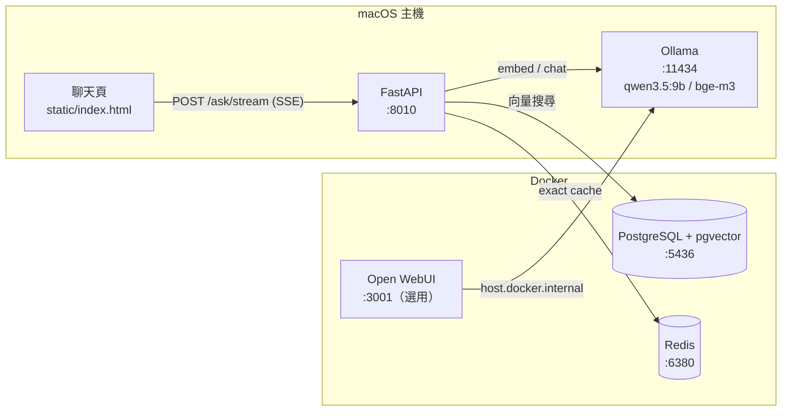

# local-rag-kit

在自己的電腦上跑完整 RAG（Retrieval-Augmented Generation）、Tool-calling Agent 與資料管線的最小可用骨架：文件 ETL、向量檢索、地端 LLM 生成、兩層快取、任意表格匯入 + Text-to-SQL、LLM 結構化擷取、會自己決定查知識庫或查資料庫的 Agent、串流聊天介面。資料不離開本機，也可以在畫面上切到雲端模型比較。

```
文件 ─────ETL─────▶ pgvector ──search_knowledge──┐
CSV / Excel ──匯入──▶ 資料表 ─────run_sql─────────┤
客訴信等文字 ─LLM 擷取─▶ 資料表 ────run_sql─────────┼──▶ Agent ──▶ 串流回答 + 引用
商品目錄 ──────────▶ products ──query_products───┘
```

- 全部服務只綁 `127.0.0.1`，不需要任何雲端帳號就能跑
- 約 1,800 行程式碼（Python 約 1,400 行 + 單頁 HTML），沒有 LangChain 這類框架，agent loop 也是手寫，每一步都看得到
- 附範例資料（員工手冊、服務條款、12 筆商品、61 筆銷售、8 封客訴信），啟動後可以直接問

---

## 目錄

- [技術選型](#技術選型)
- [系統架構](#系統架構)
- [快速開始](#快速開始)
- [使用方式](#使用方式)
- [運作原理](#運作原理)
- [Agent 與 Tool Use](#agent-與-tool-use)
- [資料管線：表格匯入與 LLM 擷取](#資料管線表格匯入與-llm-擷取)
- [拿到 API key 之後](#拿到-api-key-之後)
- [設定](#設定)
- [專案結構](#專案結構)
- [實測數據](#實測數據)
- [設計取捨](#設計取捨)
- [已知限制與後續方向](#已知限制與後續方向)

---

## 技術選型

| 層 | 技術 | 用途 | 選用理由 |
|---|---|---|---|
| LLM 執行環境 | **Ollama**（macOS 原生） | 跑地端模型、提供 HTTP API | 原生執行吃得到 Apple Silicon 的 Metal GPU；放進 Docker 只能用 CPU |
| 生成模型 | **qwen3.5:9b** | 依參考資料生成答案 | 繁中能力好、9B 在 18GB RAM 的筆電跑得動 |
| Embedding 模型 | **bge-m3**（1024 維） | 把文字轉成向量 | 多語、中文檢索表現穩定，Ollama 可直接拉 |
| 向量資料庫 | **PostgreSQL 17 + pgvector**（HNSW 索引） | 存 chunk 與向量、相似度搜尋 | 向量與 metadata 同庫，可 JOIN、可用 transaction |
| 快取 | **Redis 7** | 精確比對快取（L1） | 毫秒級回應，TTL 與 LRU 淘汰 |
| Agent | 手寫 tool-calling loop | LLM 自己決定呼叫哪個工具、帶什麼參數 | 同時支援 Ollama 與 OpenAI 相容格式（Gemini），格式差異收在 `llm.py` |
| 雲端模型 | **Gemini**（OpenAI 相容端點） | Agent 雲端模式、地端對照組 | 同一套程式切換，方便比較品質、延遲、成本 |
| API | **FastAPI** + Uvicorn | REST + SSE 串流 | 型別驗證、自動產生 Swagger |
| DB driver | psycopg 3 + psycopg-pool + pgvector-python | 連線池、向量型別轉換 | 同步 API 簡單直觀，FastAPI 自動丟 threadpool |
| HTTP client | httpx | 呼叫 Ollama / OpenAI 相容 API | 支援串流 |
| 文件解析 | pypdf、標準庫 csv | PDF / CSV / Markdown / TXT 抽取 | 依賴最少 |
| 前端 | 原生 HTML + CSS + JS | 聊天介面 | 無建置、無 CDN，斷網可用 |
| 模型測試介面 | Open WebUI（選用） | 直接跟模型對話、調 prompt | 與 RAG 流程分開，比較用 |
| 套件管理 | uv | Python 依賴與虛擬環境 | 快、lockfile 可重現 |
| 容器 | Docker Compose | 起 pgvector、Redis、Open WebUI | 一行啟動、volume 保存資料 |

---

## 系統架構



Ollama 不放進容器：Docker Desktop 在 macOS 上跑在 Linux VM 裡，拿不到 Metal GPU，9B 模型只用 CPU 會慢到不能用。

---

## 快速開始

### 需求

- macOS（Apple Silicon）或 Linux，建議 16GB 以上 RAM
- [Docker Desktop](https://www.docker.com/products/docker-desktop/)
- [Ollama](https://ollama.com/)
- [uv](https://docs.astral.sh/uv/)

### 1. 下載模型

```bash
ollama pull qwen3.5:9b
ollama pull bge-m3
```

### 2. 設定環境變數

```bash
cp .env.example .env
```

預設值就能在本機跑，不需修改。

### 3. 啟動資料庫與快取

```bash
docker compose up -d --wait
```

### 4. 安裝依賴並匯入範例資料

```bash
uv sync
uv run --env-file .env python -m app.etl data                    # RAG 知識庫
uv run --env-file .env python -m app.products data/products.csv  # Agent 用的商品表
uv run --env-file .env python -m app.tables examples/sales.csv   # 銷售資料表（Agent 用 SQL 查）
uv run --env-file .env python -m app.extract examples/extract/complaints \
  --schema examples/extract/complaint.schema.json --table complaints  # LLM 擷取客訴信（約 1 分鐘）
```

### 5. 啟動 API

```bash
uv run --env-file .env uvicorn app.main:app --port 8010 --reload
```

打開 http://localhost:8010/ 開始提問，右上角可切換「RAG 問答 / Agent · 地端 / Agent · 雲端」。

### 選用：雲端模型

Agent 雲端模式預設用 Gemini。`CLOUD_API_KEY` 留空時會自動讀 shell 的 `GEMINI_API_KEY`，key 不用寫進專案檔案：

```bash
export GEMINI_API_KEY=your-key   # 建議放在 ~/.zshenv
```

其他供應商（OpenAI、Claude、Azure）見[拿到 API key 之後](#拿到-api-key-之後)。

### 選用：Open WebUI

```bash
docker compose --profile ui up -d
```

打開 http://localhost:3001 。第一次啟動會從網路下載它自己的 embedding 模型（約 2 分鐘），之後存在 volume 裡，可離線使用。

---

## 使用方式

### 介面

| 網址 | 說明 |
|---|---|
| http://localhost:8010/ | 聊天頁。RAG 模式：串流回答、引用來源與片段預覽、快取命中層與耗時；Agent 模式：即時顯示每一步呼叫的工具、參數與結果，結尾附模型、輪數、耗時、token 數 |
| http://localhost:8010/docs | Swagger UI，逐支測 API |
| http://localhost:3001 | Open WebUI，直接跟模型對話，不經過本專案的 RAG |

### API

| Method | Path | 說明 |
|---|---|---|
| `GET` | `/health` | PostgreSQL / Redis / Ollama 狀態、chunk 數、目前使用的模型 |
| `POST` | `/ingest` | multipart 上傳 `.pdf` `.docx` `.md` `.txt` `.csv` `.xlsx` `.json`，單檔上限 20MB；內容沒變會跳過 |
| `GET` | `/search?q=&k=` | 只做檢索，回傳 top-k chunk 與相似度，用來 debug 切塊與召回 |
| `POST` | `/tables` | multipart 上傳 `.csv` `.xlsx` → 自動推斷型別建表（Excel 每個工作表一張），回傳列數、欄位型別、空值數、重複列數 |
| `GET` | `/tables` | 列出已匯入的資料表、欄位型別、列數、範例資料 |
| `POST` | `/ask` | `{"question": "...", "use_cache": true}` → 答案、來源、快取層、耗時 |
| `POST` | `/ask/stream` | 同上，SSE 串流，事件依序為 `sources` → 多個 token → `done`（`{cache, ms}`） |
| `POST` | `/agent` | `{"question": "...", "target": "local" \| "cloud"}` → 答案、工具呼叫紀錄 `trace`、輪數、token 用量、耗時 |
| `POST` | `/agent/stream` | 同上，SSE 串流，事件為 `tool_call` → `tool_result` →（重複）→ `answer` → `done`；上游錯誤送 `error` |
| `DELETE` | `/cache` | 清空所有快取 |

```bash
curl -s -X POST localhost:8010/ask \
  -H 'content-type: application/json' \
  -d '{"question":"試用期可以遠端工作嗎？"}'
```

```json
{
  "answer": "不可以，試用期（前三個月）的員工不適用遠端工作 [1]。",
  "sources": [{"source": "handbook.md", "chunk_index": 1, "score": 0.7287, "preview": "## 遠端工作\n每週最多可遠端工作 2 天…"}],
  "cache": "miss",
  "ms": 2886
}
```

```bash
# 中文 query 要 urlencode
curl -s -G localhost:8010/search --data-urlencode "q=發票期限" -d k=3
```

### 匯入自己的資料

```bash
# 整個資料夾（遞迴）或單一檔案
uv run --env-file .env python -m app.etl path/to/docs
```

或在聊天頁按「上傳文件」。支援 `.pdf` `.docx` `.md` `.txt` `.csv` `.xlsx` `.json`。

---

## 運作原理

### ETL：文件 → 向量

```
extract → clean → chunk → embed → upsert → 清快取
```

1. **Extract**（`etl.split`）：依副檔名分兩類處理。

   | 類型 | 格式 | 處理方式 |
   |---|---|---|
   | 表格類（一筆一個 chunk） | `.csv`、`.xlsx`、物件陣列 `.json` | 每筆攤平成 `欄位: 值；欄位: 值`；Excel 加上 `[工作表名]`、略過空白列與空欄位；巢狀值轉成 JSON 字串 |
   | 文件類（走切塊） | `.pdf`、`.docx`、`.md`、`.txt`、其他 `.json` | PDF 逐頁抽字；Word 的 Title / Heading N 樣式轉成 Markdown 標題，表格每列攤平；非物件陣列的 JSON 以縮排文字處理 |

2. **Clean**（`etl.clean`）：統一換行、全形空白、壓縮多餘空行。
3. **Chunk**（`etl.chunk`，文件類）：
   - 以空行切段落，累積到 `CHUNK_SIZE`（預設 500 字）為一塊
   - 遇到 Markdown 標題（`#`）強制斷開，不跨主題、不帶 overlap
   - 只有標題沒有內文的段落（例如文件大標）併進下一塊，避免產生沒有內容的 chunk 佔用檢索名額
   - 超長段落用固定長度切，相鄰塊重疊 `CHUNK_OVERLAP`（預設 80 字）避免語意被切斷
4. **Embed**：每 32 塊一批送 bge-m3。
5. **Upsert**：先比對檔案 sha256，沒變就跳過；有變則在**同一個 transaction** 內刪除舊文件（`ON DELETE CASCADE` 連帶刪舊 chunks）並寫入新的，不會出現新舊混雜的狀態。
6. **清快取**：知識庫變了，舊答案可能過期。

### 查詢：問題 → 答案

```
L1 Redis exact → embed → [L2 semantic cache] → pgvector top-k → prompt → LLM → 寫回快取
```

1. **L1 精確快取**：key = `sha256(模型名稱 | top_k | 正規化後的問題)`，命中直接回傳（約 1ms）。
2. **Embed 問題**：bge-m3 轉成 1024 維向量。
3. **L2 語意快取**（預設關閉，原因見[設計取捨](#設計取捨)）。
4. **檢索**：
   ```sql
   SELECT d.source, c.chunk_index, c.content, 1 - (c.embedding <=> $1) AS score
   FROM chunks c JOIN documents d ON d.id = c.document_id
   ORDER BY c.embedding <=> $1
   LIMIT 4;
   ```
   `<=>` 是 pgvector 的 cosine distance，走 HNSW 索引。
5. **組 prompt**：把 top-k chunk 編號成 `[1]`～`[4]`，要求模型先給結論、句尾標註引用、資料完全沒提到才拒答。
6. **生成**：qwen3.5:9b，`temperature 0.2`，`think: false`（開 thinking 單題會到分鐘級）。
7. **寫回快取**，TTL 預設 1 小時。

### 資料表

```sql
documents       (id, source UNIQUE, sha256, ingested_at)
chunks          (id, document_id → documents ON DELETE CASCADE, chunk_index, content, embedding vector(1024))
semantic_cache  (id, question, answer, sources JSONB, embedding vector(1024), created_at)
```

`chunks.embedding` 與 `semantic_cache.embedding` 都建了 HNSW（`vector_cosine_ops`）索引。Schema 在 API 或 ETL 啟動時自動建立，向量維度由 `EMBED_DIM` 決定。

直接查看資料：

```bash
docker exec -it aikit-pgvector psql -U aikit -d aikit
```

### 串流前端

`/ask/stream` 用 POST 帶 JSON，瀏覽器原生的 `EventSource` 只支援 GET，所以前端用 `fetch` + `ReadableStream` 自己解析 SSE：以 `\n\n` 切事件，讀 `event:` 與 `data:` 欄位。模型輸出一律先 escape 再把 `[n]` 轉成上標，避免 XSS。

---

## Agent 與 Tool Use

RAG 模式的流程是寫死的：每個問題都先檢索、再生成。Agent 模式把決定權交給 LLM：它看到問題和可用工具後，自己決定要不要用工具、用哪個、帶什麼參數，拿到結果再決定下一步。

```
問題：「我想幫團隊買一台 Pro 雲主機，報帳要誰核准？」
  ↓
LLM → search_knowledge({"query": "報帳核准流程"})                     → 3,000 元以下直屬主管、以上部門主管加簽
LLM → query_products({"keyword": "Pro 雲主機", "category": "雲主機"}) → SV-200，月費 2,990
  ↓
LLM：2,990 < 3,000 → 「直屬主管核准即可」
```

### 工具

| 工具 | 背後 | 適合 |
|---|---|---|
| `search_knowledge(query)` | 重用 RAG 的向量檢索 | 規定、政策、流程等非結構化文字 |
| `query_products(sku, category, keyword, max_price, min_stock, max_stock, limit)` | PostgreSQL `products` 表 | 價格、庫存等需要精確比較的數字 |
| `run_sql(sql)` | `data` schema 裡匯入或擷取出的資料表，唯讀角色執行 | 統計、排名、加總、分組、跨表 JOIN（有資料表時才出現） |

同一份商品資料同時存在向量庫（語意搜尋）和 `products` 表（精確條件）。「月費 1000 以下的資料庫」這種問題，向量相似度無法正確比大小，一定要走結構化查詢。

`query_products` 與 `run_sql` 是兩種刻意對照的設計：前者只開放結構化參數（安全、但只能問預先設計好的問題），後者讓模型寫 SQL（彈性大、靠權限層兜底）。資料結構事先知道就用前者，資料是現場才拿到的就用後者。

### Agent loop（`app/agent.py`）

```python
messages = [system, user]
for step in 1..AGENT_MAX_STEPS:
    res = llm.chat_tools(messages, tools if step < MAX else None)
    messages.append(res.message)          # 模型原生格式原樣保留
    if not res.tool_calls: return res.content
    for call in res.tool_calls:
        messages.append(tool_message(call, tools.execute(call)))
```

### 設計重點

- **不讓 LLM 寫 SQL**：`query_products` 只開放結構化參數，由後端組成參數化查詢，筆數上限 20。LLM 給的值永遠不會被拼進 SQL 字串；就算把 `'; DROP TABLE products; --` 當關鍵字傳進來，也只會被當成要比對的文字。
- **類別用 enum**：`category` 的可選值每次從 DB 取出，放進工具定義，模型不會猜出不存在的類別。
- **工具錯誤回給模型**：參數錯誤時回傳 `{"error": ...}`，不丟例外，讓模型看到錯誤後自己修正重試。
- **最後一步不給工具**：第 `AGENT_MAX_STEPS` 輪強制不帶 tools，逼模型收斂成答案，避免無限呼叫。
- **原生 message 原樣保留**：Gemini 會在 tool call 裡夾帶 thought signature，下一輪必須原封不動送回，所以不轉換成自訂格式。
- **兩種 API 格式的差異收在 `llm.py`**：Ollama 的 arguments 是物件、工具結果用 `tool_name` 對應；OpenAI 相容格式的 arguments 是 JSON 字串、用 `tool_call_id` 對應。Agent 本身不需要知道這些差異。
- **上游錯誤不外洩**：雲端 API 回 401 / 402 / 429 時，前端只看到固定訊息（例如「雲端 API 額度不足」），完整回應只寫進 server log。
- **關鍵字拆詞**：模型給「Pro 雲主機」，商品名稱是「星宇雲主機 Pro」，整串 `ILIKE` 會比對不到。改成拆詞、每個詞都要出現才算符合。這是實測時發現的問題：工具要對模型可能的輸入方式保持寬容。
- **告訴模型今天日期**：沒給日期時，問「9 月業績」模型寫出 `WHERE 日期 >= '2023-09-01'`，資料是 2026 年，查出 0 筆。
- **工具失敗不准補資料**：實測中 SQL 工具全部失敗時，模型仍回答「鼎新資訊買過 AI-01、AI-02」，完全是編的。prompt 明定「回傳 error 的部分一律視為不知道」後改善。
- **擋下重複的失敗呼叫**：9B 模型會把同一個失敗呼叫原封不動重送到步數用完。同一組 `工具名 + 參數` 失敗過就不再執行，直接回「請修改參數或說明查不到」。
- **工具說明要寫「沒有什麼」**：問「某客戶買過什麼」時，模型拿客戶名稱去查商品目錄。在 `query_products` 說明加上「這裡沒有客戶、訂單、銷售紀錄」後，改用 `run_sql` 查 sales 表。

---

## 資料管線：表格匯入與 LLM 擷取

考試或專案現場拿到的資料，通常不是整理好的文件，而是 Excel 報表或一堆信件。這兩條管線把它們變成 Agent 可以用 SQL 查詢的資料表：

```
CSV / Excel ──型別推斷──▶ data.<表>  ┐
                                     ├──▶ run_sql（唯讀角色）──▶ Agent
客訴信 ──LLM 擷取 + JSON Schema 驗證──▶ data.<表>  ┘
```

### 表格匯入（`app/tables.py`）

```bash
uv run --env-file .env python -m app.tables examples/sales.csv   # 或聊天頁「匯入資料表」、POST /tables
```

- **型別推斷**：每欄選一個「所有非空值都轉得過去」的最窄型別：`boolean` → `bigint` → `numeric` → `date` → `timestamp` → `text`。所以匯入時不會有轉型失敗的列。千分位（`3,180`）、斜線日期（`2026/08/03`）都能辨識。
- **欄名**：保留中文原名（SQL 裡以雙引號引用），空白欄名補成「欄N」、重複欄名加後綴、超過 PostgreSQL 63 bytes 上限時截斷。
- **整表替換**：`DROP` + `CREATE` + `COPY` 包在同一個 transaction。
- **匯入報告**：列數、各欄型別與空值數、重複列數。範例 `sales.csv` 刻意放了一筆重複列：

  ```
  {'table': 'sales', 'rows': 61, 'duplicate_rows': 1,
   'columns': [{'name': '日期', 'type': 'date', 'nulls': 0}, {'name': '金額', 'type': 'bigint', 'nulls': 0},
               {'name': '備註', 'type': 'text', 'nulls': 32}, ...]}
  ```

### Text-to-SQL 的安全邊界

模型寫的 SQL 一律交給專用的 `aikit_reader` 角色執行（啟動時自動建立）。真正的防線是資料庫權限，不是字串檢查：

| 層 | 做法 |
|---|---|
| 權限 | 只有 `data` schema 的 `SELECT`；`public` 的系統表（chunks、products…）讀不到 |
| 唯讀 | 角色預設 `default_transaction_read_only = on` |
| 時間 | `statement_timeout = 5s` |
| 範圍 | `search_path = data`；結果最多 50 列，超過標 `truncated` |
| 提早回饋 | 開頭非 `SELECT` / `WITH` 直接回錯誤（只是讓模型早點知道，不是防線） |

實際攻擊測試：

| 輸入 | 結果 |
|---|---|
| `SELECT 1; DROP TABLE "sales"` | DROP **有被執行到**，被唯讀 transaction 擋下 — 證明字串檢查擋不住，權限層才是防線 |
| `WITH d AS (DELETE …) SELECT …` | 擋下 |
| `SELECT … FROM public.chunks` | permission denied |
| `SELECT rolpassword FROM pg_authid` | permission denied |
| `SELECT pg_read_file('/etc/passwd')` | permission denied |
| `SELECT pg_sleep(10)` | 5 秒 timeout |
| 欄名打錯 | PostgreSQL 錯誤訊息回給模型，模型自行修正重試 |

### LLM 結構化擷取（`app/extract.py`）

```bash
uv run --env-file .env python -m app.extract examples/extract/complaints \
  --schema examples/extract/complaint.schema.json --table complaints [--target cloud --workers 4]
# CSV / Excel 中某一欄是文字時：--text-column 內容
```

流程：

1. 讀入文件：資料夾或檔案一個一筆（PDF、Word、TXT、EML…）；表格檔加 `--text-column` 時一列一筆
2. 每筆送 LLM，要求依 JSON Schema 輸出
   - Ollama：`format` 參數把輸出**在文法層級**約束到 schema，幾乎不會格式錯誤
   - OpenAI 相容端點：`response_format: json_object`，schema 放在 prompt，不保證符合
3. 用 `jsonschema`（Draft 2020-12，含 `format: date` 檢查）驗證；失敗時把**具體的驗證錯誤**連同上次輸出回給模型重試，最多 2 次
4. 依 schema 建表：`string` → `text`、`format: date` → `date`、`integer` → `bigint`、`boolean` → `boolean`、物件 / 陣列 → `jsonb`，多一欄 `_source` 記錄來源
5. 回報成功數、失敗清單（含原因）、重試次數、token 用量、耗時
6. 雲端可用 `--workers` 並行（ThreadPoolExecutor）

### Schema 的 description 就是 prompt

範例 schema 抽取 7 個欄位：客戶名稱、產品SKU（enum）、問題類型（enum）、嚴重度（1–5）、要求退款、發生日期、摘要。8 封範例信刻意放了沒署名、相對日期（「昨天」）、英文信、只寫產品名稱、條件式要求退款等情況。

| 版本 | 結果 |
|---|---|
| 第一版 schema | 8/8 通過驗證、0 次重試。日期全對（相對日期正確填 null）。但「GPU 雲主機」「Redis」對不到 SKU（schema 沒給對照表）；「若 48 小時內無法修復會要求退款」被判成要求退款；一封結尾署名的客戶名稱漏抓 |
| 在 description 加上 SKU 對照表、「條件式不算」、「名稱常在署名」 | SKU 全部正確、退款判斷正確；署名那封的客戶名稱仍漏抓（9B 模型的限制） |

**兩種約束方式的差異**（把摘要上限改成 12 字做壓力測試）：

| 路徑 | 結果 |
|---|---|
| Ollama `format`（文法約束） | 1 次就通過，但摘要是被硬截斷的：「私有 LLM 部署無法連」 |
| OpenAI 相容 `json_object` + 驗證重試 | 3 封中 2 封第一次超長，看到驗證錯誤後重寫，第 3 次通過：「海風旅宿ST-02中斷」— 語意完整的縮寫 |

**格式正確 ≠ 內容正確**：schema 驗證只保證型別與 enum 合法，內容準確度要靠 description 寫清楚領域知識，並抽樣人工核對。

### 串起來

擷取完的 `complaints` 表和匯入的 `sales` 表都在 `data` schema，Agent 的 `run_sql` 可以直接查、也能 JOIN：

> 「嚴重度 5 的客訴是哪些客戶？他們在 sales 表的累計消費多少？」

---

## 拿到 API key 之後

切換供應商只改 `.env`，不改程式。流程：

1. 把 key 貼進 `.env` 的 `CLOUD_API_KEY`（`.env` 已在 `.gitignore`，不要貼進程式碼）
2. 依供應商改下表對應的幾行
3. 自檢：
   ```bash
   uv run --env-file .env python -m app.check
   ```
   會檢查 embedding（含實際維度）、生成、地端與雲端 tool calling，每項顯示 PASS / FAIL 與原因
4. 換了 embedding 模型 → 重跑 ETL（向量表會在維度改變時自動重建）
5. **重啟 API server**：`--env-file` 只在啟動時讀一次，`--reload` 不會重讀 `.env`

### 各家設定

**OpenAI**
```env
CLOUD_BASE_URL=https://api.openai.com/v1
CLOUD_CHAT_MODEL=<信上指定的模型>
# 要用雲端 embedding 時：
EMBED_PROVIDER=openai
EMBED_MODEL=text-embedding-3-small
EMBED_DIM=1536
```

**Gemini**
```env
CLOUD_BASE_URL=https://generativelanguage.googleapis.com/v1beta/openai
CLOUD_CHAT_MODEL=gemini-flash-latest
# 要用雲端 embedding 時（預設 3072 維超過 HNSW 上限，程式會自動帶 dimensions 縮短）：
EMBED_PROVIDER=openai
EMBED_MODEL=gemini-embedding-001
EMBED_DIM=768
```

**Claude**（Anthropic 的 OpenAI 相容端點）
```env
CLOUD_BASE_URL=https://api.anthropic.com/v1
CLOUD_CHAT_MODEL=<信上指定的模型，例如 claude-sonnet-5-5>
# Claude 沒有 embedding API → EMBED_PROVIDER 維持 ollama（bge-m3），檢索留在地端
```

**Azure OpenAI**（URL 帶 deployment 名稱、用 `api-key` header）
```env
CLOUD_BASE_URL=https://<resource>.openai.azure.com/openai/deployments/<chat-deployment>
CLOUD_AUTH=api-key
CLOUD_API_VERSION=2024-10-21
CLOUD_CHAT_MODEL=<chat-deployment>
# embedding 是另一個 deployment：
CLOUD_EMBED_BASE_URL=https://<resource>.openai.azure.com/openai/deployments/<embedding-deployment>
EMBED_PROVIDER=openai
EMBED_MODEL=<embedding-deployment>
EMBED_DIM=1536
```

**生成和 embedding 用不同家**：`LLM_PROVIDER` 與 `EMBED_PROVIDER` 各自設定；embedding 走不同端點或 key 時填 `CLOUD_EMBED_BASE_URL`、`CLOUD_EMBED_API_KEY`。

### 已演練與未驗證

- 已演練：把 Ollama 的 OpenAI 相容端點（`http://127.0.0.1:11434/v1`）當成雲端，搭配 `CLOUD_AUTH=api-key`、`CLOUD_API_VERSION`，生成、串流、tool calling、embedding、多步 Agent 全部通過；embedding 維度改變時自動重建、`EMBED_DIM` 設錯時 `app.check` 會指出、超過 2000 維時啟動直接報錯
- 未用真實 key 驗證：OpenAI、Claude、Azure 端點，以及 Gemini 的 `dimensions` 參數（帳戶額度用完）。考試當天第 3 步的自檢就是為了這個

---

## 設定

所有設定都在 `.env`（範本：`.env.example`）。

| 變數 | 預設 | 說明 |
|---|---|---|
| `LLM_PROVIDER` | `ollama` | RAG 問答的生成：`ollama` 或 `openai`（下方 `CLOUD_*` 端點） |
| `EMBED_PROVIDER` | `ollama` | 同上，可與生成分開設定 |
| `EMBED_MODEL` / `EMBED_DIM` | `bge-m3` / `1024` | 向量維度必須與模型一致，上限 2000 |
| `LOCAL_CHAT_MODEL` | `qwen3.5:9b` | 地端生成模型（RAG 地端、Agent · 地端） |
| `CLOUD_BASE_URL` | Gemini 端點 | OpenAI 相容端點 |
| `CLOUD_API_KEY` | 空 | 留空時讀 shell 的 `GEMINI_API_KEY` |
| `CLOUD_CHAT_MODEL` | `gemini-flash-latest` | 雲端生成模型（RAG 雲端、Agent · 雲端） |
| `CLOUD_AUTH` / `CLOUD_API_VERSION` | `bearer` / 空 | Azure 用 `api-key` 與 `2024-10-21` |
| `CLOUD_EMBED_BASE_URL` / `CLOUD_EMBED_API_KEY` | 空 | embedding 走不同端點或 key 時才填 |
| `AGENT_MAX_STEPS` | `6` | Agent 最多呼叫幾輪 LLM |
| `CHUNK_SIZE` / `CHUNK_OVERLAP` | `500` / `80` | 切塊大小與重疊（字元） |
| `TOP_K` | `4` | 檢索幾塊 |
| `CACHE_TTL` | `3600` | 快取秒數 |
| `SEMANTIC_CACHE` | `off` | 語意快取開關 |
| `SEMANTIC_CACHE_THRESHOLD` | `0.95` | 語意快取相似度門檻 |
| `PG_*` / `REDIS_*` | 見範本 | 連線設定；port 刻意避開 5432 / 6379 |
| `PG_READER_USER` / `PG_READER_PASSWORD` | `aikit_reader` | 執行 LLM SQL 的唯讀角色，啟動時自動建立 |

只換生成、保留地端檢索是常見的混合架構：資料向量化在本機完成，只有檢索到的少量片段送到雲端。

---

## 專案結構

```
.
├── app/
│   ├── main.py          FastAPI 路由、快取流程、SSE 串流、上傳驗證、上游錯誤轉換
│   ├── agent.py         agent loop：呼叫 LLM、執行工具、回傳每一步事件
│   ├── tools.py         工具定義（JSON Schema）與執行分派
│   ├── check.py         供應商自檢：embedding 維度、生成、tool calling
│   ├── products.py      商品表匯入與參數化查詢；也可當 CLI
│   ├── tables.py        任意 CSV / Excel 匯入（型別推斷）、schema 描述、唯讀 SQL 執行；也可當 CLI
│   ├── extract.py       LLM 結構化擷取：JSON Schema 驗證、錯誤回饋重試、建表；CLI
│   ├── etl.py           7 種格式抽取、清洗、切塊、冪等寫入；也可當 CLI
│   ├── rag.py           檢索 SQL、system prompt、組 prompt
│   ├── llm.py           embed / chat / chat_stream / chat_tools；Ollama 與 OpenAI 相容（含 Azure）兩種實作
│   ├── cache.py         L1 Redis 精確快取、L2 pgvector 語意快取、清除
│   ├── db.py            schema 建立、維度變更時自動重建、唯讀角色、連線池
│   ├── config.py        讀取環境變數
│   └── static/
│       └── index.html   聊天介面
├── data/                知識庫範例資料（員工手冊、服務條款、商品 CSV）
├── examples/
│   ├── sales.csv        銷售明細（61 筆，含千分位、斜線日期、空值、1 筆重複）
│   └── extract/         客訴信 8 封 + complaint.schema.json
├── docker-compose.yml   pgvector、Redis、Open WebUI（profile: ui）
├── pyproject.toml
├── uv.lock
└── .env.example
```

---

## 實測數據

環境：MacBook Pro M3 Pro、18GB RAM、Ollama 0.35。

### RAG 模式

| 項目 | 結果 |
|---|---|
| 生成一題（未命中快取） | 2–4 秒（模型冷啟動時約 10 秒） |
| L1 快取命中 | 約 1ms（API 內部），前端含網路約 10ms |
| 8 題測試集 | 8 題回答正確，資料外問題正確拒答 |

### Agent 模式（地端 qwen3.5:9b，temperature 0）

| 問題 | 工具呼叫 | 輪數 | 耗時 | 結果 |
|---|---|---|---|---|
| 現在缺貨的商品有哪些？缺貨的話可以怎麼買？ | `query_products(max_stock=0)` → `search_knowledge` | 3 | 13.2s | 正確 |
| 月費 1000 元以下的資料庫方案有哪些？ | `query_products(category=資料庫, max_price=1000)` | 2 | 7.5s | 答案正確，**引用標錯**（標成 SV-200） |
| 我想幫團隊買一台 Pro 雲主機，報帳要誰核准？ | `search_knowledge` + `query_products` | 2 | 19.5s | 正確，並推論出 2,990 < 3,000 → 直屬主管 |
| AI 客服機器人開通後一個月想退款可以嗎？ | `search_knowledge` | 2 | 8.9s | 結論正確，但沒查商品表確認類別，且**多編了一個理由** |
| 試用期可以遠端工作嗎？ | `search_knowledge` | 2 | 8.1s | 正確 |
| 今天台北天氣如何？ | 無 | 1 | 3.7s | 正確判斷工具範圍外，不亂呼叫 |

工具選擇 6/6 正確，結構化參數（`max_stock=0`、`max_price=1000`、`category`）全部正確。弱點在引用準確度與忠實度，這也是要和雲端模型比較的部分。

### Agent 模式：Text-to-SQL（地端 qwen3.5:9b）

| 問題 | 工具呼叫 | 結果 |
|---|---|---|
| 9 月業績最高的業務是誰？ | `run_sql`（SUM + GROUP BY + 2026-09 區間） | 正確：林雅婷 37,900 |
| 各區 8–10 月營收與訂單數 | `run_sql` | 正確：南 225,370 / 25、北 89,610 / 21、中 63,950 / 15 |
| 哪個 SKU 賣最多？庫存剩多少？ | `run_sql` → `query_products` | 正確：SV-100、45 套、庫存 120 |
| 晨星診所買過哪些 AI 服務？能退款嗎？ | `run_sql` → `search_knowledge` | 正確：AI-01、AI-02；開通後不予退款 |
| 嚴重度 5 的客訴客戶在 sales 的累計消費？ | `run_sql`（complaints JOIN sales） | 正確：宏遠物流 28,830、永豐製造 32,630 |
| 要求退款的客訴有哪些？能不能退？ | `run_sql` → `search_knowledge` | 正確：3 件，依產品類別對應退款規則 |

數字皆以直接查資料庫核對。到達這個結果之前修掉的問題，依序是：

| 現象 | 修正 |
|---|---|
| 「9 月」被寫成 2023 年 | system prompt 帶入今天日期 |
| SQL 全部失敗時，模型編出購買紀錄 | prompt：error 部分一律視為不知道 |
| 同一個失敗呼叫重送到步數用完 | 相同 `工具 + 參數` 失敗過就不再執行 |
| 拿客戶名去查商品目錄 | 工具說明寫明「這裡沒有客戶與訂單」 |
| 撈明細回來**心算加總，算錯**（28,140 vs 實際 28,830） | 工具說明要求 SUM / GROUP BY 並附範例 |
| `SKU` 沒加引號被 PostgreSQL 折成 `sku`（三次測試都踩到） | 匯入時英文欄名統一轉小寫，模型加不加引號都查得到 |

最後一項的思路：**與其要求模型每次都做對，不如讓常見的錯誤寫法也能成立**。

### Embedding 相似度

bge-m3 問句相似度：

| 問句 A | 問句 B | Cosine | 意思 |
|---|---|---|---|
| 報帳 3000 **以下**誰核准？ | 報帳 3000 **以上**誰核准？ | **0.971** | 相反 |
| 特休怎麼算 | 特休天數如何計算 | 0.905 | 相同 |
| 試用期可以遠端工作嗎？ | 正職員工可以遠端工作嗎？ | 0.844 | 不同 |
| 試用期可以遠端工作嗎？ | 試用期間能不能在家上班 | 0.836 | 相同 |
| 密碼多久要換 | 密碼要幾碼 | 0.764 | 不同 |

---

## 設計取捨

**語意快取預設關閉。** 上表顯示，意思相反的問題（0.971）比同義改寫（0.836）更相似，任何門檻都會誤判。設太低會把「3000 以下」的答案回給「3000 以上」；設太高則幾乎不會命中。要開啟的話，應加二次驗證（例如用 LLM 判斷兩題是否等價，或比對數字與否定詞），或只用在答案固定的 FAQ 場景。

**用 pgvector，不用專門的向量資料庫。** 向量、原文、metadata 同庫，可以 JOIN、用 WHERE 做權限或分類過濾，ETL 也能放在單一 transaction。資料量到千萬級或需要分散式時，Qdrant / Milvus 才有明顯優勢。

**快取失效策略。** 匯入任何文件就清空全部快取；key 帶模型名稱與 top_k，換設定不會拿到舊答案。對小型知識庫來說，簡單比精準重要。

**Prompt 的拒答條件放最後。** 第一版把「沒資料就回答沒有相關資訊」放在第一條規則，9B 模型會把它當預設答案，連資料裡有的問題也拒答。改成先要求作答、拒答限定「完全沒提到主題」後才正常。

**不用 LangChain / LlamaIndex。** 這個規模的流程用框架反而看不到每一步，除錯時要繞過抽象層。

**安全。**
- 所有 port 只綁 `127.0.0.1`
- 上傳採副檔名白名單，大小在伺服器端檢查，檔名只用來顯示、不拼進任何路徑
- 前端輸出一律 escape
- `.env` 不進版控

---

## 已知限制與後續方向

**已知問題**
- 過度推論：問「可以把客戶資料丟給 ChatGPT 嗎」，模型回答「ChatGPT 屬於未核准工具」，但原文只說清單每季公告。
- 地端 9B 在 Agent 模式會標錯引用、在結論正確的前提下補上原文沒有的理由。
- 地端 9B 的多表推理不穩定：prompt 稍有變動時，曾把 complaints 與 sales 用產品 SKU（而非客戶）JOIN。temperature 0 下結果可重現，但對 prompt 措辭敏感。
- LLM 擷取：結尾署名中的公司名稱偶爾漏抓；Ollama 文法約束會把超長欄位硬截斷而不是重寫。
- 表格匯入是整表替換，沒有增量更新；型別推斷以全欄成功為準，一個髒值就會讓整欄退回 text。
- 雲端（Gemini）模式的程式已完成，但實測時帳戶預付額度用完（402），地端與雲端的對照數據尚未補上。
- 純向量檢索對精確關鍵字（SKU、法規條號）較弱。
- 單輪問答，沒有對話記憶。
- 沒有自動化評估，品質靠人工比對。

**後續方向**
- MCP server：把 `search_knowledge`、`query_products`、`run_sql` 包成 MCP server，讓 Claude Desktop / Claude Code 也能直接使用
- `POST /extract` API 與前端介面（目前擷取只有 CLI）
- 模型路由：依問題類型選地端或雲端，回應附預估成本
- 地端 vs 雲端對照：品質、延遲、token 成本
- Hybrid search：BM25 + 向量，以 RRF 合併排序
- Reranker（bge-reranker-v2-m3）對 top-k 重排
- 多輪對話：用 LLM 把追問改寫成獨立問題再檢索
- 評估：建立問答集，量 hit@k 與工具選擇正確率，用 LLM-as-judge 檢查忠實度
- 付費 API 端點加 rate limit
